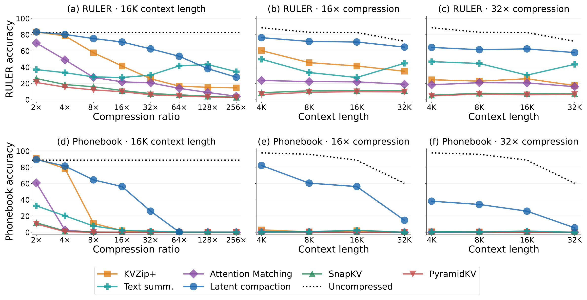
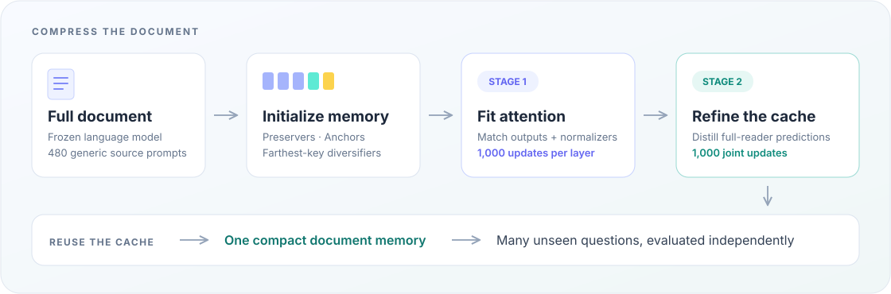

<div align="center">

# Latent Compaction with Test-Time Training

**Yingfa Chen · Xingyu Shen · Chaojun Xiao · Xu Han**

Tsinghua University

[Quick Start](#quick-start) · [Reproduce Results](docs/reproduction.md) · [Adapt the Code](docs/adaptation.md) · [Citation](#citation)

</div>

Long documents produce large KV caches. **Latent Compaction learns a smaller,
reusable cache for each document while keeping the language model frozen.** It
first matches the full cache's attention outputs and normalizers, then refines the
cache through output distillation. Both stages use generic prompts about the
document; downstream questions and answers are held out. The compacted cache is
then reused to answer many unseen questions.



**Figure 1.** Latent Compaction and budget-matched baselines on **RULER** (top)
and **Phonebook Lookup** (bottom), using Qwen3-1.7B. The curves highlight the
method's retrieval-accuracy advantage at tight cache budgets.

<details>
<summary>How the compacted cache is trained</summary>



</details>

## Installation

Use Python 3.10+ and a PyTorch build suitable for your hardware.

```bash
python -m venv .venv
source .venv/bin/activate
python -m pip install --upgrade pip
python -m pip install torch
python tools/setup.py
```

On Windows, activate with `.venv\Scripts\activate`. For CUDA-specific wheels, use
the [PyTorch installer](https://pytorch.org/get-started/locally/).
Setup installs dependencies into the active virtual environment. The code runs
directly from this checkout, without installing the project, registering a
project-specific shell command, or changing shell profiles.
[Environment and offline setup →](docs/environments.md)

## Quick Start

Train and evaluate a document cache with the paper's **1,000 / 1,000** schedule:

```bash
python run.py --method latent --model qwen3-1.7b \
  --split examples/example.json --budget 32 --output outputs/example
```

This saves the trained cache, settings, and held-out scores, including the
full-cache reference. For a one-update hardware check, add
`--config configs/smoke.json`. To ask a new question from the saved cache:

```bash
python run.py --model qwen3-1.7b \
  --cache outputs/example/cache.pt \
  --prompt 'Question: What is the observatory called? Answer:'
```

## Reproduce Results

Every experiment uses the **same method implementations**. Change the dataset,
model, context lengths, and compression ratios through arguments:

```bash
python prepare.py phonebook --model Qwen/Qwen3-1.7B \
  --lengths 4096 8192 16384 32768 --output data/phonebook

python run.py --method latent --model Qwen/Qwen3-1.7B \
  --manifest data/phonebook/manifest.json --lengths 16384 \
  --ratios 2 4 8 16 32 64 128 256 --output outputs/phonebook/latent

python aggregate.py --results outputs/phonebook/latent \
  --output outputs/phonebook/latent/summary.json
```

Use `--method kvzip`, `attention_matching`, `snapkv`, `pyramidkv`, or `summary`
for the baselines, with a separate output directory for each method. `full` runs
the uncompressed reader. The text-summary baseline generates one source-only,
budget-limited memory and reuses it across questions.

**[Full reproduction commands →](docs/reproduction.md)** for RULER, LongBench,
Phonebook Lookup, context-length curves, compression sweeps, and additional models.
No experiment-specific copies of the code are needed.

## Code Layout

```text
run.py                         # One runner for every method and dataset
prepare.py                     # Dataset preparation
aggregate.py                   # Document and task averages
latent_compaction/
├── methods/                   # One implementation per method
│   ├── latent.py              # Latent Compaction: both training stages
│   ├── kvzip.py               # KVZip+
│   ├── attention_matching.py  # Attention Matching
│   ├── snapkv.py              # SnapKV
│   ├── pyramidkv.py           # PyramidKV
│   ├── summary.py             # Text-summary baseline
│   └── full.py                # Uncompressed reference
└── ...                        # Shared attention, cache, and scoring utilities
configs/                       # Shared paper defaults and smoke settings
```

- [Reproduction guide](docs/reproduction.md) — commands and evaluation protocols.
- [Adaptation guide](docs/adaptation.md) — new datasets, models, and training settings.
- [Environment guide](docs/environments.md) — hardware, dependencies, and offline use.
- [Verification](docs/validation.md) — small-model tests and content checks.

Project code uses the [MIT License](LICENSE); bundled components retain their
[upstream licenses](THIRD_PARTY_NOTICES.md).

## How to Cite?

If you use this code in your research, please cite:

```bibtex
@misc{chen2026latentcompaction,
  title  = {Latent Compaction with Test-Time Training},
  author = {Yingfa Chen and Xingyu Shen and Chaojun Xiao and Xu Han},
  year   = {2026}
}
```
